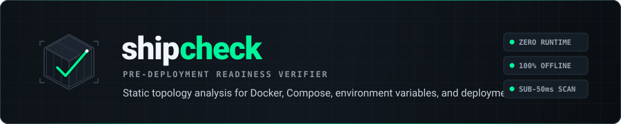
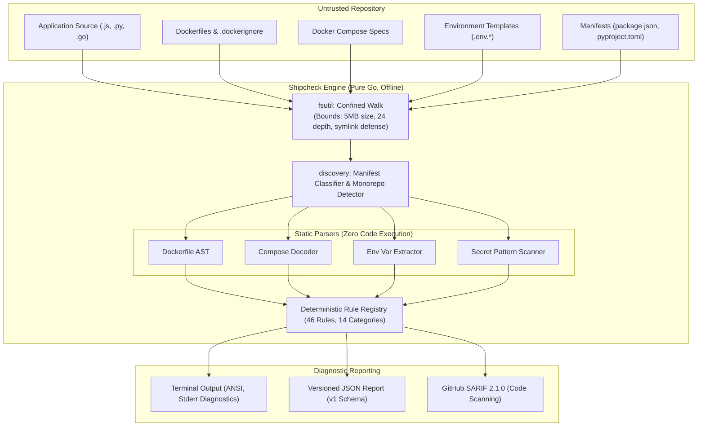

<div align="center">

<picture>
  <source media="(prefers-color-scheme: dark)" srcset="assets/branding/shipcheck-header.svg">
  <source media="(prefers-color-scheme: light)" srcset="assets/branding/shipcheck-header.svg">
  
</picture>

<br/>

**Open-source pre-deployment readiness and topology verification for containerized applications.**

[](https://github.com/deployxa/shipcheck/actions/workflows/ci.yml)
[](https://go.dev)
[](https://github.com/deployxa/shipcheck/releases)
[](LICENSE)

[Problem](#the-problem) • [How It Works](#how-it-works) • [Features](#features) • [Installation](#installation) • [Quick Start](#quick-start) • [Configuration](#configuration) • [Architecture](#architecture) • [Roadmap](#roadmap)

</div>

---

## What is Shipcheck?

**Shipcheck** is an offline, local-first static analysis tool that verifies an application repository's readiness for production deployment before code leaves your workstation or passes through a CI runner.

It identifies common causes of deployment failures—broken Dockerfile build contexts, compose files referencing missing services or undeclared volumes, development servers configured as production entrypoints, undeclared environment variables, committed credentials, and missing lifecycle signal handlers.

Shipcheck inspects static files, requires no cloud accounts or API keys, executes no untrusted code, and makes zero network calls.

---

## The Problem

Compilers check type signatures. Syntax linters enforce style guidelines. Unit test suites verify internal business logic. **None of these tools check whether an application repository is topologically and operationally deployable.**

In practice, production rollouts fail for preventable configuration and structural reasons:

- **Cross-Manifest Inconsistencies:** Application source reads `process.env.API_KEY`, but the variable is missing from `.env.example`, compose environments, and Dockerfile `ENV` declarations.
- **Compose Topology Failures:** A `docker-compose.yml` service references a `depends_on` service or named volume that was never declared at the root level, causing orchestrators to fail during rollout.
- **Development Leakage:** A Dockerfile `CMD` runs `npm run dev`, `vite`, `flask run`, or `nodemon`, resulting in missing optimizations, unhandled memory growth, and exposed internal stack traces.
- **Uncontrolled Lifecycle Termination:** HTTP servers fail to register `SIGTERM` listeners, causing orchestrators to fall back to `SIGKILL` timeouts and drop active in-flight user requests during zero-downtime rolling deploys.
- **Credential Spillage:** Live keys, tokens, or private certificates are inadvertently committed to the repository.

Traditional linters inspect individual files in isolation. Shipcheck walks the repository as an **integrated deployment graph**, validating relationships across source code, manifests, Dockerfiles, Compose files, and environment definitions.

---

## How It Works

Shipcheck analyzes repositories as untrusted input. It executes a single confined filesystem walk, extracts project topology, runs a pure deterministic rules engine, and formats findings:



---

## Output Contract

Every finding emitted by Shipcheck adheres to a structured, 3-axis contract:

```console
$ shipcheck ./my-app

Shipcheck 0.1.0-rc1 — open-source production-readiness checks
Project: /workspace/my-app
Detected projects: node:apps/api, node:apps/web
Scanned 64 files in 0.04s

[CRITICAL/confirmed] SC-BLD-001 apps/api/package.json:6 — Development server used as production entrypoint
    evidence: scripts["start"] = "nodemon server.js"
    explanation: Production entrypoint invokes nodemon; dev servers lack graceful drain and leak stack traces.
    fix: Change "start" to execute the production runtime: "node server.js".

[HIGH/confirmed] SC-CMP-001 docker-compose.yml:14 — depends_on references an undefined service
    evidence: service "web" depends on "cache", but "cache" is not declared in services
    explanation: Docker Compose will fail manifest validation during container deployment.
    fix: Define service "cache" in docker-compose.yml or remove the depends_on entry.

[HIGH/confirmed] SC-CMP-002 docker-compose.yml:22 — Named volume is not declared at top level
    evidence: service "api" mounts named volume "redis_data", but top-level volumes key is missing
    explanation: Modern Compose specifications reject undeclared top-level named volumes.
    fix: Add "volumes:\n  redis_data:" to top-level docker-compose.yml.

[MEDIUM/probable] SC-ENV-001 apps/api/src/db.js:12 — Referenced environment variable is not declared in any template
    evidence: DATABASE_URL is read in 2 location(s) but declared in no template (.env.example, compose, Dockerfile)
    explanation: Missing environment variables produce silent fallbacks or immediate runtime crashes upon deployment.
    fix: Add DATABASE_URL to .env.example or declare it in the compose environment block.

Summary: 1 critical, 2 high, 1 medium, 0 low, 0 info
Exit condition: 3 finding(s) at or above high threshold (exit 1)
```

### The 3 Evaluation Axes

1. **Severity (Operational Blast Radius):**
   - `CRITICAL`: Guaranteed deployment failure, root container compromise, or confirmed credential leak (e.g., Docker socket passthrough).
   - `HIGH`: Broken configuration that will prevent orchestrator startup (e.g., unresolvable `depends_on`, undeclared volume).
   - `MEDIUM`: Anti-pattern or configuration drift (e.g., container running as `root`, undeclared environment variables).
   - `LOW`: Best-practice advisory with low operational risk (e.g., missing graceful shutdown handler, unpinned tags).
   - `INFO`: Informational diagnostic observation (e.g., optional healthcheck omitted).

2. **Confidence (Evidential Certainty):**
   - `confirmed`: Unambiguous, structural fact (e.g., invalid YAML syntax, missing referenced file).
   - `probable`: Strong evidential correlation where external context might exist (e.g., variable read in source code but not declared in templates).
   - `possible`: Heuristic observation requiring human review (e.g., generic password assignment string).

3. **Check Nature:**
   - `static`: Pure static inspection of file content and directory trees.
   - `validated`: Verified via opt-in local subsystem validation (`--docker-validate`).
   - `inconclusive`: Check could not definitively prove condition due to safe bounds (e.g., oversized file, skipped depth).

---

## Features

### Implemented Capabilities

- **46 Static Readiness Rules across 14 Domains:** Covers startup scripts, port collisions, Dockerfile hygiene, Compose topologies, build contexts, graceful shutdown, environment variable drift, filesystem persistence, and secret leaks.
- **Topology Discovery:** Automatically detects single projects and multi-project monorepos for Node.js (`package.json`, lockfiles) and Python (`pyproject.toml`, `requirements*.txt`, lockfiles).
- **Environment Variable Analysis:** Distinguishes referenced, declared, required, optional, and unresolved variables across source code and deployment templates.
- **Secret Detection & Sanitization:** Detects AWS keys, GitHub tokens, Slack tokens, Stripe live keys, Google API keys, NPM tokens, and private keys. All matched values are permanently masked at extraction time.
- **Machine-Readable Outputs:** Versioned JSON report conforming to the published [`shipcheck-report.v1` schema](docs/schema/shipcheck-report.v1.schema.json) and SARIF 2.1.0 for GitHub Code Scanning.
- **Defensive Confinement:** Confines all filesystem walking within the scanned root, prevents symlink escapes, rejects path traversal (`../`), and caps memory usage (5 MiB file size limit, 24 directory depth limit, 20,000 file limit).
- **Zero Runtime Execution:** Never runs build scripts, package managers (`npm`, `pip`), or container runtimes.

### Experimental Capabilities

- **Subprocess Compose Validation (`--docker-validate`):** Optionally invokes `docker compose config` in a sandboxed subprocess with a bounded 45-second timeout to validate compose syntax against the local Docker engine. Reports inconclusive if Docker is absent.

### Planned Capabilities

- **Additional Language Ecosystems:** Manifest support for Go (`go.mod`), Rust (`Cargo.toml`), and Java (`pom.xml`, `build.gradle`).
- **Auto-Remediation Mode (`--fix`):** Interactive generation of missing `.env.example` templates and Dockerfile `USER` directives.
- **Baseline Diffing:** Ability to ignore existing findings and fail only on newly introduced defects.

---

## Installation

### Prerequisites

- **Prebuilt Binaries:** No dependencies required (fully self-contained, statically linked).
- **From Source:** Go 1.22 or higher.

### Option 1: Using `go install`

```bash
go install github.com/deployxa/shipcheck/cmd/shipcheck@latest
```

### Option 2: Prebuilt Static Binaries

Download pre-compiled binaries from the [GitHub Releases](https://github.com/deployxa/shipcheck/releases) page:

```bash
# Example: Download for macOS (Apple Silicon / ARM64)
curl -sSL https://github.com/deployxa/shipcheck/releases/download/v0.1.0-rc1/shipcheck-0.1.0-rc1-darwin-arm64.tar.gz | tar -xz
sudo mv shipcheck /usr/local/bin/

# Example: Download for Linux (AMD64)
curl -sSL https://github.com/deployxa/shipcheck/releases/download/v0.1.0-rc1/shipcheck-0.1.0-rc1-linux-amd64.tar.gz | tar -xz
sudo mv shipcheck /usr/local/bin/

# Verify installation
shipcheck version
```

### Option 3: Build from Source

```bash
git clone https://github.com/deployxa/shipcheck.git
cd shipcheck
make build
./bin/shipcheck --help
```

---

## Quick Start

### 1. Scan a Local Repository

Run a static inspection against your application directory:

```bash
shipcheck ./my-app
```

### 2. Configure Severity Threshold for CI

Fail pipeline runs only when findings meet or exceed a specific severity level (default: `high`):

```bash
shipcheck ./my-app --severity-threshold critical
```

### 3. Generate Machine-Readable Reports

Generate pure JSON or SARIF reports:

```bash
# JSON output conforming to shipcheck-report.v1 schema
shipcheck ./my-app --format json --output report.json

# SARIF output for security dashboards
shipcheck ./my-app --format sarif --output shipcheck.sarif
```

### 4. Inspect the Built-in Rule Catalogue

Print the complete rule registry directly from the binary:

```bash
shipcheck rules --format markdown
```

---

## Configuration

Shipcheck operates with zero configuration by default. You can adjust behavior by adding an optional `.shipcheck.yml` in your project root:

```yaml
# Severity threshold that causes non-zero exit: critical | high | medium | low | info (Default: high)
severity_threshold: high

# Additional directory names to skip during discovery
exclude:
  - legacy-fixtures
  - vendor
  - playground

# Disable specific rules by their stable contract ID
disable_rules:
  - SC-DCK-002    # Explicitly permit running as root in this repository
  - SC-PORT-001   # Explicitly permit hardcoded host port binding

# Skip real .env files when collecting variable names (Default: true)
# When set to false, variable NAMES are parsed to reduce false positives, but values are never stored.
skip_real_dotenv: true
```

> **Strict Validation:** Unrecognized configuration keys are immediately rejected with exit code `2`. This ensures that configuration typos cannot silently disable checks.

---

## Exit Codes Contract

Shipcheck conforms to a deterministic Unix exit code specification suitable for automated pipelines:

| Code | Status | Meaning |
| :---: | :--- | :--- |
| **`0`** | **Clean** | Scan completed; no findings meet or exceed the active severity threshold. |
| **`1`** | **Findings** | Scan completed; findings at or above the severity threshold exist (CI gate fails). |
| **`2`** | **Usage Error** | Invalid invocation (unrecognized flag, invalid project path, malformed configuration). |
| **`3`** | **Internal Error** | Unexpected runtime crash or internal invariant violation. |
| **`4`** | **Incomplete** | Scan completed, but analysis was incomplete (e.g., oversized files or symlink escapes skipped). All collected findings are still output. |

---

## CI/CD Integration

### GitHub Actions (with Code Scanning SARIF Upload)

Create `.github/workflows/production-readiness.yml`:

```yaml
name: Production Readiness Gate

on:
  push:
    branches: [main]
  pull_request:

jobs:
  shipcheck:
    name: Shipcheck Readiness Scan
    runs-on: ubuntu-latest
    permissions:
      contents: read
      security-events: write # Required for SARIF upload

    steps:
      - name: Checkout Code
        uses: actions/checkout@v4

      - name: Set up Go
        uses: actions/setup-go@v5
        with:
          go-version: '1.22'

      - name: Install Shipcheck
        run: go install github.com/deployxa/shipcheck/cmd/shipcheck@latest

      - name: Run Scan
        run: |
          shipcheck . \
            --severity-threshold high \
            --format sarif \
            --output shipcheck.sarif

      - name: Upload SARIF to GitHub Security Tab
        if: always()
        uses: github/codeql-action/upload-sarif@v3
        with:
          sarif_file: shipcheck.sarif
```

### GitLab CI

```yaml
stages:
  - test

shipcheck:
  stage: test
  image: golang:1.22
  script:
    - go install github.com/deployxa/shipcheck/cmd/shipcheck@latest
    - shipcheck . --severity-threshold high --format json --output shipcheck-report.json
  artifacts:
    when: always
    paths:
      - shipcheck-report.json
```

---

## Architecture

Shipcheck is designed around a single-pass, read-only pipeline with isolated package responsibilities:

| Package | Responsibility | May Access Disk? |
| :--- | :--- | :---: |
| `cmd/shipcheck` | CLI process entrypoint | No |
| `internal/cli` | Argument parsing, exit code orchestration, diagnostics | No |
| `internal/fsutil` | Confined walking, defensive caps, symlink containment | **Yes (Only package)** |
| `internal/discovery` | Manifest recognition, project detection, monorepo classification | Via `fsutil` |
| `internal/parse` | Pure decoders for Dockerfiles, Compose YAML, package manifests | No |
| `internal/envvar` | Cross-referencing variable usage against declarations | No |
| `internal/secrets` | Conservative token pattern matching and masking | No |
| `internal/rules` | Pure analysis engine evaluating 46 rules over parsed input | No |
| `internal/config` | Strict `.shipcheck.yml` loading and schema enforcement | Root config only |
| `internal/validate` | Opt-in Docker Compose CLI validation subprocess | No (Shells out) |
| `internal/output` | Formatted human terminal, JSON v1, and SARIF 2.1.0 renderers | No |

---

## Security & Limitations

### Defensive Guarantees

- **No Code Execution:** Shipcheck does not execute build steps, lifecycle scripts, or application code.
- **Path Confinement:** All content-derived paths (e.g., `COPY` destinations, compose volume binds) are evaluated through `fsutil.Resolve` and bounded to the repository root.
- **Credential Masking:** Matches under `SC-SEC-*` are masked before reaching report structures (`AKIA********`, `ghp_********`). Unmasked values are never printed.
- **Resource Caps:** Files > 5 MiB are skipped; recursion is capped at 24 directory levels; repositories are capped at 20,000 files.

### Known Limitations

- **Runtime Environment Variables:** Variables injected dynamically at runtime by cloud platforms (e.g., AWS ECS task definitions, Kubernetes ConfigMaps) cannot be detected in static mode.
- **Dynamic File Generation:** Files created during CI build phases (e.g., compiled assets, generated `.env` files) will appear missing in static scans performed before the build step.
- **Complex Shell Wrappers:** Custom wrapper scripts that alias or obscure process startup commands (e.g., custom shell runners wrapping `nodemon`) are not resolved through deep shell tracing.

---

## Roadmap

### Completed (v0.1.0-rc1)
- [x] Recursive project discovery for Node.js, Python, Docker, Compose, and Procfiles.
- [x] Core rules engine with 46 rules across 14 operational categories.
- [x] Environment variable cross-referencing and token leak masking.
- [x] Machine-readable versioned JSON (`v1`) and SARIF 2.1.0 output.
- [x] Opt-in `--docker-validate` compose verification.
- [x] Comprehensive test suite with synthetic positive/negative fixtures.

### In Progress
- [ ] Automated release automation and Homebrew packaging.
- [ ] Rule suppression comments inline in Dockerfile and Compose YAML (`# shipcheck:ignore SC-DCK-002`).

### Proposed
- [ ] Native manifest discovery for Go (`go.mod`), Rust (`Cargo.toml`), and Java (`pom.xml`).
- [ ] Auto-remediation flag (`--fix`) for standard template and Dockerfile defaults.
- [ ] Historical diff analysis against baseline git commits.

---

## Contributing

Contributions are welcome! Please review [CONTRIBUTING.md](CONTRIBUTING.md) for local setup, development guidelines, and instructions on authoring new detection rules.

### Local Development Gate

Before submitting a pull request, ensure all tests and formatters pass:

```bash
make check      # Runs gofmt, go vet, and all package tests
make docs       # Re-generates docs/rules.md from the rule registry
```

To report security vulnerabilities, please consult our [Security Policy](SECURITY.md).

---

## Documentation Index

| Resource | Contents |
| :--- | :--- |
| [CLI Reference](docs/cli.md) | Command syntax, flags, exit codes, and output streams |
| [Rule Catalogue](docs/rules.md) | Detailed documentation for all 46 rules and remediations |
| [Configuration Reference](docs/configuration.md) | Complete `.shipcheck.yml` specification and schema |
| [JSON Schema Specification](docs/schema/shipcheck-report.v1.schema.json) | Formal schema for JSON report integration |
| [Architecture Specification](docs/architecture.md) | Internal subsystem designs and package invariants |
| [Threat Model & Security](docs/threat-model.md) | Defensive bounds, untrusted input policies, and sandboxing |
| [False-Positive Methodology](docs/false-positives.md) | Evidence grading, confidence tiers, and accuracy calibration |
| [Test Fixtures Specification](docs/fixtures.md) | Synthetic test fixtures used for deterministic regression testing |

---

## License

Shipcheck is licensed under the [MIT License](LICENSE).  
Copyright © 2026 [Deployxa](https://deployxa.com).
